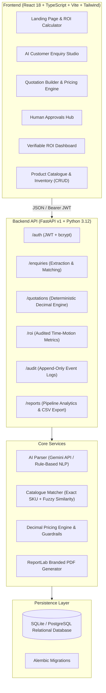

# VyaparPilot AI — Verified AI Co-Pilot for MSME Productivity

**Track 4-01: AI Co-Pilot for MSME Productivity with Verifiable Return on Investment**  
*PRAGYAN 2K26 National-Level Hackathon*

---

## 1. Executive Summary & Problem Statement

Small and medium-sized enterprises (MSMEs)—especially small manufacturers, distributors, and wholesalers in industrial hubs across India—receive dozens of unstandardized customer enquiries every day via WhatsApp messages, emails, and phone notes.

### The MSME Problem:
1. **Time-Consuming Manual Work:** Estimators spend 30 to 45 minutes cross-referencing messy WhatsApp texts with Excel sheets, printed price lists, and stock registers to locate matching SKUs.
2. **Pricing Errors & Margin Erosion:** Manual calculations under high pressure result in forgotten GST components (CGST vs. IGST), accidental excessive discounts, and quotations issued below cost price.
3. **Delayed Responses Cause Lost Deals:** Buyers frequently award contracts to the first supplier who delivers a professional, accurate quote within the hour.
4. **Unverifiable Productivity Claims:** Existing AI tools make generic, speculative claims without providing an audited, data-backed measurement of actual time and cost savings.

### The VyaparPilot AI Solution:
VyaparPilot AI automates the end-to-end quotation workflow while keeping the business owner firmly in control:

$$\text{Customer Enquiry} \longrightarrow \text{AI Extraction} \longrightarrow \text{Catalogue Matching} \longrightarrow \text{Price \& Stock Validation} \longrightarrow \text{Quotation Generation} \longrightarrow \text{Human Approval} \longrightarrow \text{PDF Export} \longrightarrow \text{Verifiable ROI Measurement}$$

---

## 2. Core Differentiators

1. **Deterministic Calculations, Not AI Guesses:** LLMs extract customer requirements into validated Pydantic JSON schemas. **AI is never permitted to invent prices, catalogue SKUs, stock levels, or discounts.** All financial calculations use precise Decimal math on the backend.
2. **Automated Pricing Guardrails:** Configurable business rules automatically detect and flag underpriced items, gross margins below company thresholds (<15%), excessive discounts (>20%), and warehouse stock shortages.
3. **Verifiable Return on Investment (ROI) Hub:** Tracks the exact seconds spent across every phase (AI extraction time, human review time, correction time) against a manual baseline. Calculates net monetary return in Indian Rupees (₹) using real database records.
4. **Human Approval Workflow & Digital Sign-Off:** Quotations must be approved by authorized managers before official branded PDFs can be exported. Every status change is immutably recorded in an append-only audit trail.
5. **Zero-Config Demo Mode:** Works immediately out of the box without requiring external paid API keys. Includes an offline rule-based NLP parser with transparent fallback.

---

## 3. System Architecture



---

## 4. Technology Stack

- **Frontend:** React 18, TypeScript, Vite, Tailwind CSS, Lucide Icons, Recharts, React Router v6.
- **Backend:** Python 3.12, FastAPI, Pydantic v2, SQLAlchemy 2.0, Alembic, ReportLab.
- **Database:** SQLite (local zero-config development), compatible with PostgreSQL.
- **AI Integration:** Google Gemini 1.5 Flash API with deterministic rule-based NLP fallback.
- **Testing:** Pytest (11 automated critical-path tests), FastAPI TestClient.

---

## 5. Prerequisites

- **Python:** 3.10+ (tested on Python 3.12.10)
- **Node.js:** v18+ (tested on Node.js v24.18.0)
- **npm:** v9+

---

## 6. Quick Start Instructions (Local Setup)

### Step 1: Clone or Open the Workspace
```powershell
cd c:\Users\HP\OneDrive\Desktop\Timestop
```

### Step 2: Set Up Backend Virtual Environment & Dependencies
```powershell
python -m venv backend\venv
backend\venv\Scripts\pip install -r backend\requirements.txt
```

### Step 3: Run Alembic Database Migrations & Seed Demo Data
```powershell
# Run database migrations
cd backend
venv\Scripts\alembic.exe upgrade head
cd ..

# Seed database with sample MSME business, 18 catalogue products, quotations, and ROI records
backend\venv\Scripts\python.exe scripts\seed_demo_data.py
```

### Step 4: Install Frontend Dependencies & Build
```powershell
cd frontend
npm install
npm run build
cd ..
```

---

## 7. Starting the Application

You can launch both servers using separate terminal windows or the provided batch scripts:

### Terminal 1: Backend (FastAPI on Port 8000)
```powershell
cd backend
venv\Scripts\uvicorn.exe app.main:app --host 127.0.0.1 --port 8000 --reload
```
*Backend API will be accessible at: [http://127.0.0.1:8000](http://127.0.0.1:8000)*  
*Interactive Swagger Documentation: [http://127.0.0.1:8000/docs](http://127.0.0.1:8000/docs)*

### Terminal 2: Frontend (Vite on Port 5173)
```powershell
cd frontend
npm run dev
```
*Frontend application will be accessible at: [http://localhost:5173](http://localhost:5173)*

### Alternative: Windows One-Click Batch Scripts
- `scripts\seed_demo.bat` — Seeds or resets the demo database.
- `scripts\run_backend.bat` — Starts the FastAPI backend.
- `scripts\run_frontend.bat` — Starts the Vite frontend.

---

## 8. Demo Account Credentials (For Hackathon Judges)

The seed script creates a complete, realistic MSME workspace:
- **Business Name:** Apex Industrial & Electro-Mech Solutions Pvt. Ltd. (Pune, Maharashtra)
- **Email:** `demo@vyaparpilot.in`
- **Password:** `demoPassword123!`
- **One-Click Demo Login:** Available on the login page via the **"1-Click Launch Demo Workspace"** button.

---

## 9. Running Automated Tests

A comprehensive Pytest suite covers authentication, multi-tenant isolation, Decimal pricing calculations, pricing guardrails, ReportLab PDF generation, and ROI formulas.

```powershell
cd backend
venv\Scripts\pytest.exe -v
```

**Test Results:**
```
app/tests/test_api.py::test_health_check PASSED                          [  9%]
app/tests/test_api.py::test_auth_login PASSED                            [ 18%]
app/tests/test_api.py::test_auth_demo_login PASSED                       [ 27%]
app/tests/test_api.py::test_get_current_user_profile PASSED              [ 36%]
app/tests/test_api.py::test_product_catalogue_listing PASSED             [ 45%]
app/tests/test_api.py::test_deterministic_pricing_engine PASSED          [ 54%]
app/tests/test_api.py::test_pricing_guardrail_low_margin_warning PASSED  [ 63%]
app/tests/test_api.py::test_pricing_guardrail_unmatched_product PASSED   [ 72%]
app/tests/test_api.py::test_roi_calculation_formulas PASSED              [ 81%]
app/tests/test_api.py::test_quotation_pdf_generation_endpoint PASSED     [ 90%]
app/tests/test_api.py::test_tenant_data_isolation PASSED                 [100%]
======================= 11 passed in 8.28s =======================
```

---

## 10. Required End-to-End Acceptance Scenario Walkthrough

Follow these steps to demonstrate the end-to-end workflow:

1. **Launch App & Sign In:**
   - Open [http://localhost:5173](http://localhost:5173).
   - Click **"Launch Demo Workspace"** to enter as *Apex Industrial Solutions*.
2. **Review Product Catalogue:**
   - Navigate to **"Product Catalogue"** in the sidebar.
   - Inspect the 18 pre-loaded industrial components (Motors, Cylinders, Cables, Contactors, Valves).
3. **Process an Unstructured Enquiry:**
   - Navigate to **"AI Enquiry Studio"**.
   - Click the preset button **"Sample 1: Chakan Motors & Pneumatics"**.
   - Click **"Run AI Verification"**.
   - Observe the extracted items, quantities, and units. Notice that catalogue products are matched with exact SKU codes, stock counts, and verified unit prices in INR.
4. **Check Inventory & Pricing Guardrails:**
   - Load **"Sample 3: Stock Warning & Low Margin Trigger"** and run verification.
   - Observe the stock alert: *Requested 10 PCS VFD, but only 6 available in warehouse stock*.
5. **Convert into Quotation in Builder:**
   - Click **"Convert to Verified Quotation in Builder"**.
   - Review live calculations: Subtotal, GST (9% CGST + 9% SGST or 18% IGST), Freight, and Gross Margin %.
   - Notice the pricing guardrail alert flagging low gross margin (<15%).
6. **Submit for Approval:**
   - Click **"Submit for Approval"**. The quotation transitions to `PENDING_APPROVAL`.
7. **Human Approval & Risk Governance:**
   - Navigate to the **"Approvals Queue"** tab.
   - Open the quotation, review the risk warnings and pricing breakdown, and click **"Approve"**.
8. **Generate Branded PDF:**
   - Click **"Download Official PDF"**. A high-resolution, print-ready PDF is generated by ReportLab with complete GST details, bank coordinates, and digital sign-off stamp.
9. **Inspect Verifiable ROI Dashboard:**
   - Navigate to **"Verifiable ROI"**.
   - View the audited metrics derived from actual database records:
     - Average turnaround reduction from 35.0 mins down to 2.6 mins (92.5% time saved).
     - Net monetary productivity value calculated using the configured labour rate (₹350/hr).
     - Filter between *Measured Workflow Tests* and *Seeded Baseline Records*.
10. **Inspect Audit Trail:**
    - Navigate to **"Audit Trail"** to verify the immutable log of every action taken.

---

## 11. Mathematical ROI Methodology

All metrics displayed in VyaparPilot AI are calculated from stored database records using these deterministic formulas:

- **Time Saved per Quotation:**
  $$T_{\text{saved}} = T_{\text{manual\_baseline}} - (T_{\text{AI\_processing}} + T_{\text{human\_review}} + T_{\text{correction}})$$
- **Percentage Time Reduction:**
  $$\text{Reduction \%} = \left(\frac{T_{\text{saved}}}{T_{\text{manual\_baseline}}}\right) \times 100$$
- **Estimated Labour Value Unlocked:**
  $$\text{Labour Value} = \left(\frac{T_{\text{saved}}}{3600}\right) \times \text{Staff Labour Cost per Hour (INR ₹)}$$
- **Net Economic Benefit:**
  $$\text{Net Benefit} = \text{Labour Value} - \text{AI API Operating Costs}$$

---

## 12. Docker & Container Deployment

To run the complete application in Docker:

```powershell
docker-compose up --build
```
- Frontend: [http://localhost:80](http://localhost:80)
- Backend: [http://localhost:8000](http://localhost:8000)

---

## 13. Security & Multi-Tenancy

- **Password Security:** Salted hashes generated using `bcrypt` (never stored in plain text).
- **Authentication:** Stateless JSON Web Tokens (JWT) using `HS256` with 7-day expiration.
- **Tenant Isolation:** Every database query filters by `business_id == current_user.business_id`. Cross-tenant ID guessing returns HTTP 404.
- **Data Protection:** Secrets and external API keys are read strictly from backend environment variables and never exposed to the frontend browser.
