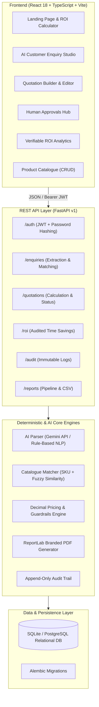
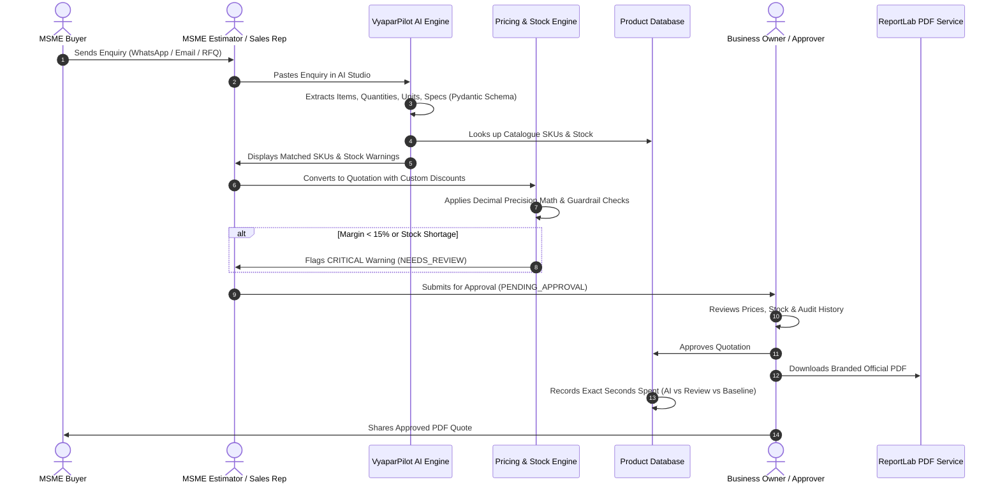

# VyaparPilot AI — System Architecture & ROI Methodology
**Track 4-01: AI Co-Pilot for MSME Productivity with Verifiable Return on Investment**
*PRAGYAN 2K26 National-Level Hackathon*

---

## 1. High-Level Architecture Overview

VyaparPilot AI combines natural-language AI extraction with deterministic financial calculation engines, inventory validation guardrails, and verifiable time-and-motion ROI logging.

---

## 2. End-to-End Workflow Sequence

The core quotation lifecycle ensures that AI never invents prices, catalogues, or stocks. All business rules are enforced deterministically on the backend:

---

## 3. Mathematical Methodology for Verifiable ROI

Unlike speculative productivity claims, VyaparPilot AI records the exact duration of each workflow phase directly in the relational database:

1. **Manual Baseline Time ($T_{\text{manual}}$)**:
   The configured historical time required to prepare a quotation manually without AI assistance (default: $35.0\text{ minutes} = 2100\text{ seconds}$).

2. **Total AI-Assisted Turnaround ($T_{\text{assisted}}$)**:
   $$T_{\text{assisted}} = T_{\text{AI\_processing}} + T_{\text{human\_review}} + T_{\text{human\_correction}}$$
   *Typical average: $15\text{s} + 115\text{s} + 30\text{s} = 160\text{s} \approx 2.67\text{ minutes}$.*

3. **Time Saved per Quotation ($T_{\text{saved}}$)**:
   $$T_{\text{saved}} = \max(0, T_{\text{manual}} - T_{\text{assisted}})$$

4. **Percentage Time Reduction**:
   $$\text{Reduction \%} = \frac{T_{\text{saved}}}{T_{\text{manual}}} \times 100$$

5. **Estimated Labour Value Unlocked ($\text{LV}$)**:
   $$\text{LV} = \left(\frac{T_{\text{saved}}}{3600}\right) \times \text{Staff Wage per Hour (INR ₹)}$$

6. **Net Productivity Benefit**:
   $$\text{Net Benefit} = \text{Labour Value} - \text{AI API Operating Costs}$$

---

## 4. Multi-Tenancy & Security Isolation

- **Business Scoping**: Every table (`products`, `customers`, `enquiries`, `quotations`, `audit_events`, `productivity_measurements`) carries a strict `business_id` foreign key.
- **Authorization Enforcement**: All backend API endpoints extract `current_user` from the cryptographically verified JWT bearer token and enforce `filter(business_id == current_user.business_id)`.
- **Zero Cross-Tenant Leakage**: Attempting to query or modify another tenant's record ID returns an HTTP 404 response. Verified by automated tests.
